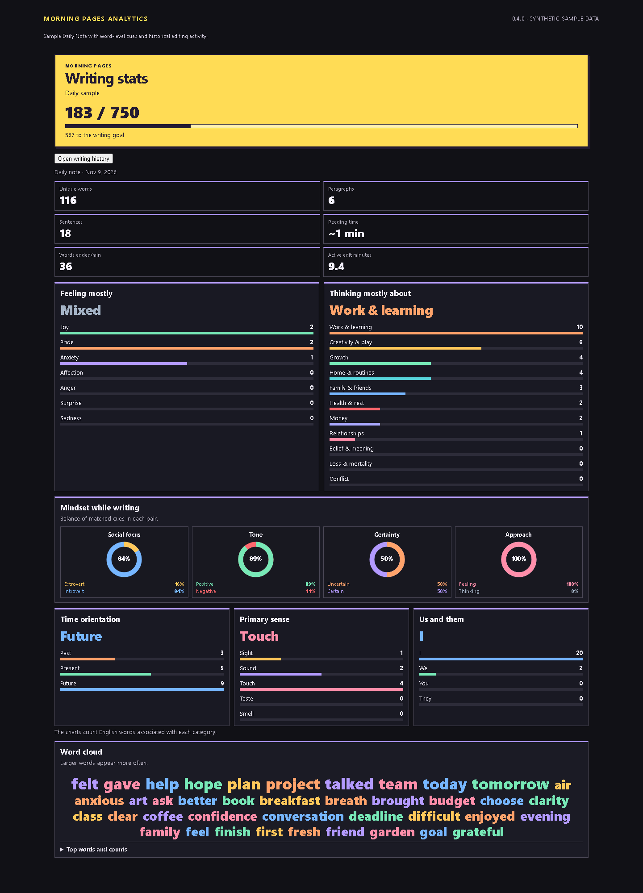
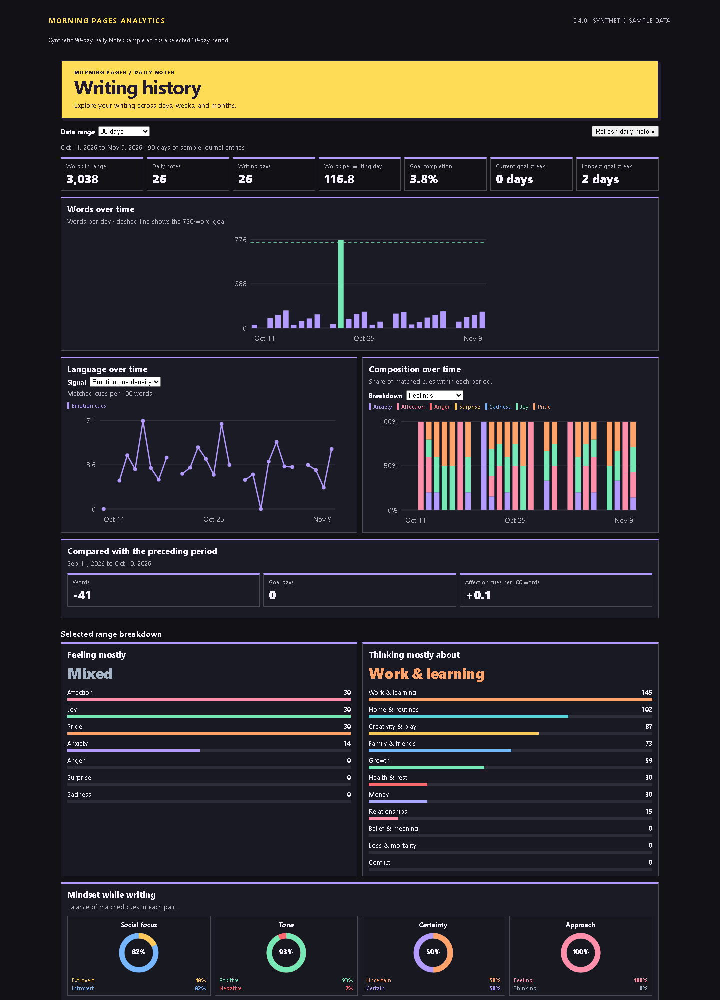

# Morning Pages Analytics

Morning Pages Analytics is an MIT-licensed Obsidian plugin for local writing analysis and Daily Notes history. Open a note to see its writing stats, or explore patterns across your daily notes.


## See each note in more detail

**Open writing stats** opens the sidebar for the active note. It shows the word count and live word cloud, plus charts for:

- Feelings such as anxiety, affection, anger, surprise, sadness, joy, and pride.
- Topics such as growth, health, creativity, work, home, belief, people, money, relationships, loss, and conflict.
- Four paired mindset dimensions for social focus, positive/negative tone, certainty, and feeling/thinking.
- Past/present/future cues, five senses, and I/we/you/they pronouns.

The language signals use literal English word cues. They count listed words in the note; they do not understand context, negation, sarcasm, or other languages as semantic analysis would. Treat them as countable signals, not a definitive reading of intent.

Words added per minute is shown only when the stats pane observes enough editing activity to measure it. No pace estimate is shown otherwise.

## Explore patterns over time

The plugin reads the configured Daily Notes folder and date format. On startup it backfills matching notes, then updates its local index when notes are saved, created, renamed, or deleted. **Refresh daily history** rereads the Daily Notes configuration.

To include more folders, open **Settings → Morning Pages Analytics → Additional writing folders** and select **Add folder** for each vault-relative path, such as `Journal/Morning Pages`. Choose **Automatic filename dates** to recognize twelve common formats together with no format entry, including `2026-09-13`, `September 13 2026`, `September 13, 2026`, `13 September 2026`, and `Sep 13 2026`. **Selected filename formats** provides twelve preset toggles, a Daily Notes format option, and optional custom formats (one per line); multiple formats are active simultaneously. **Creation timestamp** accepts any Markdown filename. Filename modes skip nonmatching or ambiguous dates without falling back to timestamps. For example, automatic mode skips `03-04-2026`; select only day-first or month-first to resolve it. Existing single-format rules migrate without changing their behavior. Changing sources automatically reorganizes history. Daily Notes retain filename-date precedence; for overlapping additional folders the most specific folder wins. Use **Remove** to stop tracking a folder.

Folder changes refresh writing history automatically after typing settles. Editing a note updates its analysis without moving its creation date. Nested subfolders are included by default. Settings also provide a Daily Notes filename format override (blank inherits Obsidian's format), an include-subfolders toggle, a default history range, and newest/oldest creation-time order within a day. Notes without valid creation timestamps are skipped rather than assigned a modification date. File copying or sync tools can reset filesystem creation timestamps; these dates reflect the timestamps reported by Obsidian, not reconstructed original dates.

**Open writing history** shows 7, 30, 90, 365, All, and custom date ranges. The dashboard includes word totals, writing and goal streaks, tone and topic trends, language composition, a date calendar, day-by-day entry inspection, and a word cloud with exact word-frequency counts. Finite ranges can be compared with the preceding period.

## Local data

The v2 plugin cache stores note paths, dates, file metadata, and numeric analysis counts. It does not persist note text or keyword counts. Word-cloud counts are rebuilt from the selected notes and kept in memory for up to four date ranges.

## Build and install

Requires Node.js 22 or later.

```sh
npm run build
npm test
```

The tests include a dashboard scroll regression in Chrome or Chromium when available. Release checks require a browser so that the dashboard is tested with real layout and scrolling.

To install from the ZIP, extract its `morning-pages-analytics` folder into `.obsidian/plugins` in your vault. You can also copy the three release files into that folder. Restart Obsidian, enable **Morning Pages Analytics** in Community plugins, and run **Open writing history** from the command palette.

[Releases](https://github.com/remriel/morning-pages-analytics/releases)

## Screenshots

Screenshots below use synthetic sample writing.






## License

Morning Pages Analytics is released under the [MIT License](LICENSE).

If you find the plugin useful, you can [buy me a coffee](https://buymeacoffee.com/remriel).
